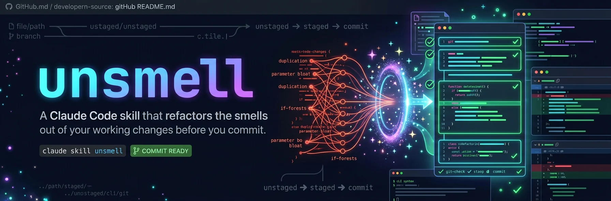

# /unsmell



A [Claude Code](https://claude.com/claude-code) skill that refactors the smells
out of your working changes before you commit them. Every rule lives in
[SKILL.md](skills/unsmell/SKILL.md); this page says what the skill does for you
and where each rule is.

## What it finds

It reads what you have changed (unstaged, staged and untracked) and checks it
against a catalog of smells in a few families: duplication and repeated facts,
blind types and unnamed values, functions and files that do too much, missing
receivers and misplaced rules, unparsed input, generic machinery written inline,
and docs that restate the code instead of linking its design decision. The full
list is the catalog, SKILL.md §4.

## How it finds them

- **Whole files, not hunks.** Each touched file is read end to end, and a set of
  passes looks for what a read for flow misses (SKILL.md §3.1).
- **A role for every function.** Each changed function is taken apart by what
  its lines do (§3.1, "Role pass").
- **Docs from the design.** A doc links its item to the design decision in your
  ADRs or design docs (§3.1, "A doc carries the design" and "Design link").
- **Fresh eyes.** The survey runs in fresh subagents, one per batch of related
  files, plus one that looks across batches (§3.0).

## What you see

Every step writes its result in a run directory under the repo's git directory,
so you can read what was found and decided before looking at any edit (§3.0).

You review the changes one at a time in your own working tree and answer accept,
reject, plan or later (§3.0, step 6). At the end your index comes back with
every accepted line staged (§3.0, step 8). The run commits nothing to a branch
(§3.0, step 5).

Every finding ends in one bucket, and the survey covers the whole changeset
every time (§5). When you point at a smell it missed, it sweeps for every
sibling of that kind (§5.1).

Style comes from written rules only, never from the surrounding code (§2).

## Install

In Claude Code, from the shared
[nikicat/claude-plugins](https://github.com/nikicat/claude-plugins) marketplace:

```
/plugin marketplace add nikicat/claude-plugins
/plugin install unsmell@nikicat
```

The repo is still its own marketplace too
(`/plugin marketplace add nikicat/unsmell`, then
`/plugin install unsmell@unsmell`).

For local development: `claude --plugin-dir /path/to/unsmell` (single session),
or `/plugin marketplace add /path/to/unsmell` (tracks your working tree).

Before committing, run `pre-commit install` once. The hook wraps the markdown at
80 columns, and CI fails on a file it would change.

`/unsmell` appears in the skill list after a restart.

## Update

```
/plugin marketplace update nikicat
/plugin update unsmell@nikicat
```

Then restart Claude Code. The first command refreshes the marketplace so the
second one sees the new version.

## Use

```
/unsmell
/unsmell only src/parser.rs
/unsmell only changeset-local fixes
/unsmell duplication only, report only
/unsmell the whole auth module, aggressive
/unsmell patches only
/unsmell just do it
```

Arguments are free text, not flags — they narrow the scope, filter the catalog,
or shift the fix/ask balance. See §1 of [SKILL.md](skills/unsmell/SKILL.md) for
the full set.

## Not this

Not a bug hunter and not a linter — it's about shape, not correctness or
formatting. Run your test suite; it will too, and it reports honestly when
something fails.
